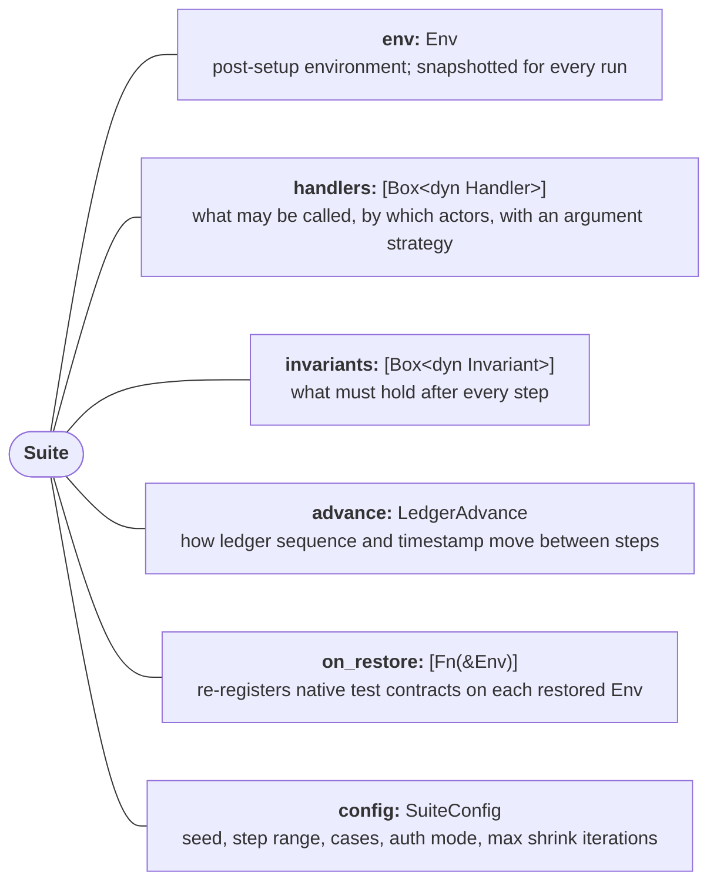
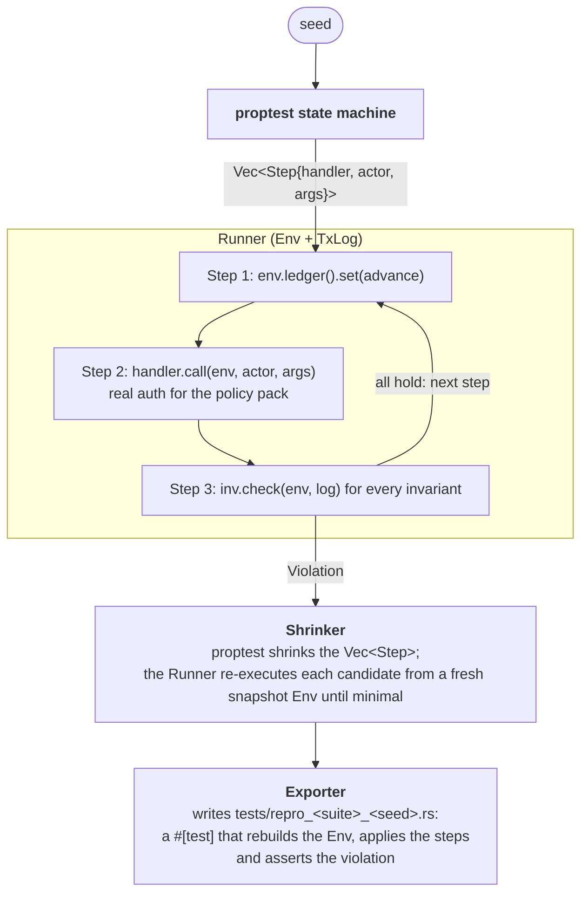

# Architecture

This document describes Breakwater as implemented. When the implementation changes, update this file in the same PR.

## 1. Goals and non-goals

**Goals**

- Let a Soroban developer declare *actors*, *handlers* and *invariants* in plain Rust and get stateful fuzzing with shrinking, without writing harness code.
- Run entirely in-process against `soroban_sdk::Env` so a suite is just `cargo test`.
- Make findings reproducible: every failure is a deterministic, exportable unit test.
- Ship attack packs that encode Stellar-specific knowledge (smart-account policies, TTL archival).

**Non-goals (for the hackathon)**

- Coverage-guided fuzzing (`cargo-fuzz` / libFuzzer). Random generation plus shrinking is enough to demo; coverage guidance is a roadmap item.
- Formal verification. That is Certora Sunbeam's job.
- Mainnet execution. Testnet replay of a shrunk sequence is the on-chain evidence.

## 2. Core concepts



### `Actor`

A named signer with a Soroban address. Because an `Address` is bound to the `Env` that created it and every run uses a freshly restored `Env`, an `Actor` stores the address as a strkey string and materialises it with `actor.address(&env)`. Handlers and invariants hold contract ids the same way (`Address::from_str(&env, &strkey)`). For the `policy-bypass` pack, actors map onto smart-account signers (owner key, agent session key, revoked key) so that the authorization path is exercised with the right credential.

### `Handler`

```rust
pub trait Handler: Send + Sync + 'static {
    type Args: Clone + Debug + Serialize + DeserializeOwned + Send + Sync + 'static;
    fn name(&self) -> &'static str;
    fn actors(&self) -> &[Actor];
    fn strategy(&self) -> BoxedStrategy<Self::Args>;        // proptest
    fn call(&self, env: &Env, ctx: &CallContext, actor: &Actor, args: &Self::Args)
        -> Result<CallOutcome, HandlerError>;
    fn args_from_json(&self, value: &serde_json::Value) -> Option<Self::Args> { /* serde default */ }
}

pub enum CallOutcome {
    Success,                        // expected
    SuccessWith(serde_json::Value), // expected, with the call's return value (`CallOutcome::returning(v)`)
    ContractError(u32),             // expected: a graceful `contracterror`
    Unauthorized,                   // expected: the host rejected the authorization
}
```

A handler wraps one contract function. `call` is expected to succeed or fail *gracefully* (a `contracterror`, reported as `CallOutcome::ContractError`, or an authorization rejection, reported as `CallOutcome::Unauthorized`). A `HandlerError` or a bare panic is treated as a bug and ends the sequence with a `Violation` of kind `handler_error` or `panic`, matching the convention in `soroban-token-fuzzer`. `CallContext` carries the step index, the auth mode, a per-step nonce and a signature expiration ledger for handlers that build real authorization entries. `Args` must be `Serialize` and `DeserializeOwned` so that steps can be logged, exported and replayed; the suite type-erases them internally. Each executed step becomes a `StepRecord` in the `TxLog`: handler, actor, arguments as JSON, ledger gap, ledger sequence and timestamp, outcome, and `return_value` (the JSON the handler attached with `SuccessWith`), all of which reach the exported report.

### `Invariant`

```rust
pub trait Invariant {
    fn name(&self) -> &'static str;
    fn check(&self, env: &Env, log: &TxLog) -> Result<(), Violation>;
}
```

Invariants read contract state through the normal client and the `TxLog` (the sequence of steps executed so far, with outcomes). They are checked after **every** step, not only at the end, so the shrunk reproduction stops at the first violating step. A `Violation` carries `kind` (`invariant`, `panic`, `handler_error`), `source` (the invariant or handler name, filled in by the runner), `message` and an optional JSON `detail`.

### `LedgerAdvance`

Controls how `env.ledger()` moves between steps. The gap is generated as part of each step, so it is deterministic for a seed and shrinks with the sequence:

- `Still`
- `Fixed { ledgers, seconds }` (default: one ledger, five seconds)
- `Random { ledgers: RangeInclusive<u32> }`; the timestamp follows at `SECONDS_PER_LEDGER` (5 s) per ledger
- `Profile(Vec<(usize, Gap)>)` — a usage profile: `(steps, gap)` segments applied in order, the last gap repeating once the profile is exhausted. `LedgerAdvance::daily_then_silence(30, 90)` builds "one call a day for 30 days, then nothing for 90 days", the profile the `ttl-archival` pack runs under.

Because the gap is stored in each generated step, shrinking keeps the gaps of the steps it retains: a profile-driven failure shrinks to the few steps that carry the decisive gaps (for the stream demo: the creation and the step after the 90-day silence).

## 3. Execution pipeline



**Why `proptest-state-machine`.** It already provides sequence generation, preconditions (so we do not generate obviously invalid steps) and shrinking of sequences. Writing a custom shrinker in two days is not realistic; reusing this is the single biggest time saver in the plan.

**Env reuse.** Setting up contracts from scratch per shrink candidate is slow and non-reusable. The suite keeps the post-setup `Env` and restores a fresh one for every generated sequence and every shrink candidate with `Env::from_ledger_snapshot(base.to_ledger_snapshot())`. Two facts about `soroban-sdk` 28 shape this:

- Ledger entries (instance, persistent and temporary storage, contract instances, ledger info) survive the round trip. Native Rust test contracts registered with `env.register(..)` do **not**: they live in the host, not in the ledger. The suite therefore runs the `on_restore` hooks on every restored `Env`, and the suite author re-registers native contracts there with `env.register_at(&address, Contract, ())`, which keeps the restored instance storage intact.
- `mock_all_auths()` and the budget are per-`Env`, so the runner re-applies them on every restore.

**Determinism.** Seed → sequence is reproducible. The CLI prints the seed on every failure and accepts `--seed` to replay.

## 4. Authorization model

Two modes, chosen per suite:

| Mode | How | Used by |
| --- | --- | --- |
| `MockAll` | `env.mock_all_auths()` on every restored `Env` | general handlers where auth is not what is under test |
| `Real` | No mocking. Before each call the handler installs real `SorobanAuthorizationEntry` values with `env.set_auths(..)`; the host runs the custom account's `__check_auth` and its policies | `policy-bypass` pack |

In `Real` mode the smart account's policies are genuinely enforced by the Soroban host, so a sequence that gets through is a real bypass, not a mocking artifact. The pieces:

- `breakwater::auth` (core, protocol-level): `contract_fn` builds the invocation tree, `signature_payload` hashes the `HashIdPreimage::SorobanAuthorization` the host expects to be signed, `address_entry` wraps it all in `SorobanAddressCredentials`. `CallContext` gives each step a unique nonce and a signature expiration ledger.
- `breakwater_pack_policy_bypass::auth::authorize` (OpenZeppelin-specific): produces the account entry whose signature is an `AuthPayload { signers, context_rule_ids }`. An `External` signer signs the SHA-256 digest of `AuthDigestPreimage { account, signature_payload, context_rule_ids }`. A `Delegated` signer gets a second entry whose root invocation is `account.__check_auth(preimage)`, because the account authenticates it with `require_auth_for_args`.
- `classify` maps the result of a `try_` call: a `Contract` error is `CallOutcome::ContractError`; an `Auth` error or `Error(Context, InvalidAction)` (how the host surfaces a `__check_auth` rejection to the caller) is `CallOutcome::Unauthorized`; anything else is a bug.

Measured on the demo suite (Apple Silicon, debug build): 86 cases and 280 steps in 1.3 s, about 5 ms per step including two policy calls, an Ed25519 signature and the nested owner entry. Generation therefore runs under `Real` directly; the fallback of generating under `MockAll` and re-verifying only the shrunk sequence under `Real` was not needed.

## 5. Attack packs

### `policy-bypass`

Target: an OpenZeppelin `stellar-contracts` 0.8.0 smart account (`examples/policy-bypass`; its owner key account, spending-limit policy and Ed25519 verifier are separate crates under `examples/policy-bypass/contracts/`, because one cdylib cannot export two `__check_auth`, and `DemoAccount` has a constructor that installs the initial rules, because an account with zero rules can never authorize `add_context_rule` on itself) with two context rules: rule 0 (`Default`) for the owner, a `Signer::Delegated` hardware-key account, and rule 1 (`CallContract(usdc)`) for the agent, a `Signer::External` Ed25519 key, carrying two `SpendingLimit` policy instances: 50 USDC per ledger (the de-facto per-call cap) and 100 USDC per "day".

The deliberate defect is in that last number. OpenZeppelin's `SpendingLimit` measures its window in **ledgers** (`period_ledgers`), and at Stellar's ~5 s close time a day is 17 280 ledgers. The demo installs 1 728, as an operator who divides 86 400 s by 50 instead of 5 would. Every single call still respects both caps; only a sequence that waits out the 2.4-hour window shows that "100 USDC per day" is really "100 USDC per 2.4 hours". Mistaking a day for a ledger count is exactly the kind of real-world configuration error the pack exists to catch.

| Invariant | What it asserts |
| --- | --- |
| `RollingCap` | `Σ spend in window ≤ limit`, computed from `TxLog`, compared to what the policy let through |
| `AllowlistOnly` | every successful call hit a contract/function in the configured allow-list |
| `RevokedNeverAuths` | no call succeeded with a signer revoked earlier in the sequence |
| `PinnedWasm` | policy/verifier WASM hashes at check time equal those at setup |

Generators bias toward known bypass shapes: `amount_near_cap` draws mostly `cap - 1`, and `window_straddling_advance` draws ledger gaps uniformly over one and a half policy windows so about a third of them cross the boundary. Signer rotation is represented by the owner's `revoke_agent` handler (`remove_signer`). Re-creating the agent's rule (`remove_context_rule` + `add_context_rule`) is not generated yet: under `Real` auth the policy `install` callbacks require the sub-invocation tree, including the not-yet-assigned rule id, to be pre-built in the owner's authorization entry. That is deferred.

Invariants evaluate the `TxLog`: `RollingCap` sums the agent's successful `transfer` amounts inside the intended window (17 280 ledgers) and fires when the sum exceeds 100 USDC, however the policy was configured. `PinnedWasm` compares `Address::executable()` of the account, policies and verifier against the values captured at setup. Note that `SpendingLimit` keeps its state under `(smart_account, context_rule_id)`: changing the limit or the period means a new rule, and a new rule starts with an empty history, which is the root of the rule-rotation bypass and the next generator shape to add.

### `ttl-archival`

Target: `examples/ttl-archival`, a payment stream (`create_stream`, `withdraw`, `cancel`) that keeps streams in persistent storage and the token address plus id counter in instance storage, and never calls `extend_ttl`. `PaymentStreamFixed` (behind the `fixed` feature) is the same contract extending every touched entry to the stream's remaining duration; it is the control.

Two facts about `soroban-sdk` 28 shape the pack:

- **Archived persistent and instance entries are restored on access.** Since Protocol 23 a transaction whose restore list names an archived entry restores it before running (simulation fills that list); the test `Env` emulates this, so a contract read of an archived entry succeeds and resets the entry's TTL to the network minimum. Only temporary entries vanish. The `testutils` `get_ttl` getters go through the same path and therefore cannot observe an archived entry.
- **`live_until` can be read without touching the entry.** `env.host().get_stored_entries()` lists every ledger entry with its `live_until`; `breakwater_pack_ttl_archival::ttl` filters it by contract, key and durability. That is the only side-effect-free probe, and it is what the invariants use. `Env::host()` is a `testutils`-only accessor to the host implementation rather than a documented contract API; the dependency is isolated in `ttl.rs` and covered by a test so an SDK change surfaces immediately.

Invariants read the set of running streams from the `TxLog` (`StreamModel`: creations, cancellations, durations; ids follow creation order), never from the contract, so checking never restores anything:

| Invariant | What it asserts |
| --- | --- |
| `NoMidLifecycleExpiry` | every running stream's persistent entry has TTL > 0 (0 is the last live ledger; negative means archived) |
| `InstanceAlive` | while any stream is running, the contract instance has TTL > 0 |
| `RestoreRestoresFunction` | for every running stream whose entry is archived, a throwaway `Env::from_ledger_snapshot` copy is taken, natives are re-registered, and a suite-supplied probe calls `withdraw` and `cancel` there; both must succeed (or `withdraw` may report `NothingToWithdraw`). The fuzzed `Env` is untouched |
| `NoUnboundedTtlExtension` | no stream entry's `live_until` exceeds the stream's end ledger plus a slack (one day in the demo), and the instance's does not exceed the latest running stream's end plus the slack; the network minimum TTL is always allowed. Catches a public, unauthenticated `extend_ttl` entry point used to keep data alive at the contract's rent |
| `RestoreCostWithinBudget` | a measured handler that runs while running-stream entries (or the instance) are archived stays within a `ResourceBudget` of the host's metering for that call: instructions, memory, disk read entries and bytes, write entries and bytes. The demo budgets 3 disk-read entries and 1 000 bytes; in the seed-3 run the first call after a quiet quarter, `withdraw_many([0])`, restores the instance, the stream and the token balances at once: 5 disk-read entries, 1 384 bytes read, 6 entries and 1 588 bytes written, 235 660 instructions |

The budget numbers are an approximation. The SDK meters a native test contract, so Wasm instantiation and the transaction's own size are missing, and the test host counts the first read of a live entry as a disk read too; the invariant therefore measures only steps taken while an entry it watches was archived, remembering every watched entry's `live_until` from its previous check. Disk reads and writes do include the restored entries, which is the signal that matters here.

The usage profile is what makes the pack bite. The demo `Env` sets the minimum persistent TTL to 30 days so that the story fits a quarter; the real minimum is a network configuration parameter (`state_archival.min_persistent_ttl`) that is changed by network upgrades, so read it from the network rather than from documentation: on 25 October 2026 `stellar network settings --network testnet` reported 120 960 ledgers (about seven days), and the demo stream deployed on Testnet at ledger 5383730 is accordingly live until ledger 5504689. The mainnet value was not queried for this project; Stellar Lab's network limits page shows it. Under `daily_then_silence(30, 90)` the buggy contract fails in two steps: `create_stream` (365 days), then 90 days of silence, and the next call finds stream 0 archived with 275 days left to run, its TTL having run out 60 days earlier. The fixed contract holds under the same profile. Measured: 63 cases and 621 steps in 0.6 s under `MockAll`. Two further suites in `examples/ttl-archival/tests/suite.rs` drive the second defect and the restoration cost: `keep_alive_suite` finds `create_stream`, `create_stream`, `bump_ttl(stream 0, 6 311 999 ledgers)` by anyone, leaving the entry alive 1.3 days past the stream's end plus slack; `restore_cost_suite` finds three `create_stream` calls, 90 days of silence and one `withdraw_many([0])` that restores five entries in one call.

**What archival costs on-chain.** Auto-restore does not make the bug harmless. The next transaction that touches an archived entry must restore it and pay for the restoration: it implicitly adds that entry's `diskReadBytes` and `writeBytes` (the restoration is a read from the archive and a write back into the live state), and a transaction that touches several archived entries at once can exceed the per-transaction limits and fail with `INVOKE_HOST_FUNCTION_RESOURCE_LIMIT_EXCEEDED`; a transaction built without the restore fails outright. Because the demo contract never extends TTL, a restored entry is archived again after every quiet period of at least the minimum TTL. In the other direction, `extend_ttl` can only lengthen a TTL, never shorten it, so a public, unauthenticated extension entry point lets anyone keep useless data alive indefinitely while the honest users carry the rent.

**Real-world precedent.** After the mainnet upgrade to Protocol 23 on 2025-09-03, it was found on 2025-10-09 that Protocol 23 had archived 478 contract entries with stale values; 84 of them had been restored into live state, and 77 entries were modified. Validators paused archival eviction, a stellar-core patch on 2025-10-10 quarantined the affected entries, and Protocol 24 (CAP-0076) on 2025-10-22 fixed the inconsistency ([stellar.org, Addressing state archival inconsistencies](https://www.stellar.org/blog/developers/addressing-state-archival-inconsistencies-protocol-upgrade-vote-next-week)). The archive-and-restore path is where mainnet's most recent real incident happened, and it is exactly the path this pack probes.

### `budget-snapshot`

Target: any suite. Unlike the other two packs this one has no invariant to violate: it measures what each handler costs, stores the statistics in `.breakwater-snapshot.json` and compares a later run with them. `examples/ttl-archival` is the demo (suite `ttl-archival-budget`, seed 7, up to twenty one-day steps so that no call pays for restoring an archived entry), and its two regression features are the changes the gate is shown to catch: `regress-demo` adds one persistent write to `withdraw`, and `regress-compute` makes `cancel` hash a 64-byte buffer twelve times, which costs CPU and moves no storage figure.

**The metering layer.** The host meters every top-level invocation separately: when one starts it clears the CPU and memory counters, the events and the storage footprint (the ledger state itself is kept), and when it ends it computes `InvocationResources` for the whole call tree, sub-calls and `__check_auth` included. `env.cost_estimate().resources()` and the host's `get_last_invocation_resources` return only the *last* one, so a reading belongs to the call you meant only if nothing was invoked since. `env.cost_estimate().budget()` is a subset (CPU instructions, peak memory, a per-cost-type tracker) and is not used. Nothing here needs a manual reset, and the runner's `reset_unlimited()` on each restored `Env` only lifts the CPU and memory limits; it neither changes the counts nor disables the separate mainnet `InvocationResourceLimits` every test `Env` enforces, so a call that exceeds those still ends the run as a `panic` violation.

That drives where the reading is taken. Invariants run after the handler and often read the contract through a client, which is an invocation and would overwrite the reading, so sampling cannot live in an invariant. `Metered<H>` wraps a handler, forwards every `Handler` method and, right after the inner `call` returns, reads the last invocation. It records a sample only if the call succeeded and the host says the last top-level invocation was the declared `Target` (contract and function; the comparison is on the derived `Debug` text of the host's description, because that type is not reachable through `soroban-sdk`, and a test pins it). Anything else is counted as unattributed and makes `Recorder::finish` fail, so a helper call after the measured one is refused rather than misread. Setup calls (minting, `register_at` in `on_restore`) happen before the measured call and are overwritten by it; advancing the ledger and signing are not invocations. Samples are grouped by handler name, not by step: a step has no identity across seeds, a handler does. The same property would let a handler that reports success without invoking anything inherit the previous step's record, so before every call `Metered` makes the last invocation something that is never the target: an empty `Env::as_contract` frame, which the host meters as a call of the empty function name. Comparing the record before and after the call instead would misread a second call with identical, deterministic costs. The marker is an invocation of its own, and the host clears the events when any invocation starts, so a handler that makes no call in a step also finds the previous step's events gone; a handler that makes its call is not affected, because its own invocation clears them anyway. A suite needs one invariant, so `RecordOnly` is provided; if a real invariant fires, the sequences stop early and `finish` refuses the incomplete measurement.

**The file.** Format version 1, only integers, ordered maps, a trailing newline:

| Field | Meaning |
| --- | --- |
| `format`, `toolchain` | Layout version and the resolved `soroban-sdk`, `soroban-env-host` and core library versions, read from `cargo metadata`. The cost model is in `soroban-env-host`, so its patch version counts |
| `suites.<name>` | `seed`, `cases`, `steps`, `auth`, `mode` (`native`) and `workload_digest`, an FNV-1a 64 over every executed `(handler, actor, arguments, ledger sequence)`, whatever the outcome |
| `handlers.<name>` | `samples` and, for each of the twelve resources, `max` and `p50` (the lower median, `sorted[(n-1)/2]`) |

`snapshot` replaces only its own suite and refuses to relabel other suites in the file with a different toolchain.

**The comparison** (`breakwater_pack_budget_snapshot::compare_tiered`; `compare` is the case of one tolerance for everything). If the toolchain, mode, authorization, seed, cases, step range, workload digest or handler set differ, the snapshot is stale and is not compared. Otherwise each handler's `max` and `p50` must satisfy `current * 10000 <= baseline * (10000 + tolerance_bps)`; a zero baseline allows only zero. Values below the baseline by more than the tolerance are reported as improvements and do not fail. A different sample count under the same workload fails, because a handler whose calls start to fail would otherwise leave the measurement unnoticed. The sequence strategy never reads the `Env`, so for a fixed seed a contract change moves the resource values and nothing else.

The tolerance is looked up per resource in a `Tolerances`: the one set for the resource, else the one for its class, else a bare value for all resources, else 5%. A resource's class is decided in one place, `Resource::class`, which lists every variant so that a new resource has to be classified to compile:

<!-- resource-classes:start -->
- storage: `disk_read_entries`, `memory_read_entries`, `write_entries`, `disk_read_bytes`, `write_bytes`, `contract_events_size_bytes`, `persistent_rent_ledger_bytes`, `persistent_entry_rent_bumps`, `temporary_rent_ledger_bytes`, `temporary_entry_rent_bumps`
- compute: `instructions`, `mem_bytes`
<!-- resource-classes:end -->

Storage figures follow the call's own footprint and are held to 0% in this repository's CI. `instructions` and `mem_bytes` also follow the `Env`'s history (see Limits) and get 5%. The tolerances are a property of the command that checks, not of the snapshot: the file format is unchanged (still version 1) and a baseline can be checked under any tolerance. `Finding` and `Verdict` do not carry the tolerance a value was judged by; the CLI looks it up again with `Tolerances::resolve` when it prints a line.

**Why a recording is reproducible.** The figures are the host's modelled costs, not timings. The suites register contracts natively, so no Wasm bytecode, and therefore no compiler version or optimisation level, enters the numbers. The workload comes from a seeded ChaCha generator, the test `Env` uses a fixed PRNG seed and counter-based addresses, and the file holds no timestamps, paths or floats.

**Limits.** `native` mode leaves out Wasm instantiation and VM execution, the transaction size and the rent of the Wasm code, so `instructions` and `mem_bytes` are only good for comparing revisions of one code base; the storage figures are exact for the entries the contract touches. The distribution is the one the seed generates, not an upper bound. `instructions` and `mem_bytes` also depend on how many ledger entries the `Env` has touched before the call, because the host's storage map is a copy-on-write ordered map whose every insert copies it (`MemAlloc`, `MemCpy` and `MemCmp` grow with its size, measured at roughly 280 instructions per touched entry for a call writing one entry); the storage figures come from the call's own footprint and do not. Entries present only in the ledger snapshot cost nothing until touched, and on the network the map holds only the transaction's footprint. See the README section for the experiment. The compute class has a second blind spot: a native test contract's own Rust code is not metered, only the host functions it calls, so `instructions` follows host work (hashing, signature checks, serialisation, host containers) and not plain arithmetic; this is why `regress-compute` hashes. A compute tolerance also lets a CPU-only regression below it pass: on the demo, one more hash in `cancel` is about 1.5%. A Wasm mode would add a `mode` value and measure real bytecode, at the price of numbers that follow the toolchain.

## 6. CLI

<!-- ANCHOR: cli -->
```
breakwater run    <suite-dir> [--seed N] [--steps A..=B] [--auth mock|real] [--json <file>] [--no-color]
breakwater export <suite-dir> --out <file.rs> [--seed N] [--from <run.json>]
breakwater report <run.json> [--html <file>]
breakwater snapshot <suite-dir> [--seed N] [--steps A..=B] [--auth mock|real] [--file <path>] [--features a,b]
breakwater snapshot <suite-dir> --check [--tolerance 5%|storage=0%,compute=5%] [--file <path>] [--suite <name>] [--features a,b]
```

`run` executes `cargo test --manifest-path <suite-dir>/Cargo.toml --test suite breakwater_suite -- --exact` with `BREAKWATER_SEED`, `BREAKWATER_STEPS`, `BREAKWATER_AUTH` and `BREAKWATER_REPORT` in the environment. The suite applies the first three through `SuiteConfig::from_env`, writes its `RunReport` to the fourth through `Exporter::write_if_requested`, and returns without asserting when it is driven that way; the CLI judges the JSON. Cargo's own output goes to stderr unchanged; the CLI prints the header, the shrunk sequence one step per line (index, handler, actor, ledger gap, arguments as `k=v`, outcome), the violation and the seed to reproduce with.

`export` turns the shrunk sequence into a regression test: a file that embeds the steps as JSON and calls `common::replay_json`, the entry point each example's `tests/common/mod.rs` exposes. That function rebuilds the fixture and calls `Suite::replay`, which executes exactly the recorded steps (handler and actor by name, arguments rebuilt by `Handler::args_from_json`, gaps as recorded) and checks every invariant after each. The generated test asserts the same invariant fails at the same step with the same message. `examples/*/tests/repro_*.rs` are such files, committed as regression tests.

`report` renders a JSON report in the terminal, and with `--html` writes a single static page (inline CSS and SVG, no scripts, no external resources): header, step timeline over ledger sequence with the violating step highlighted, per-step table, and a cumulative-spend chart with the limit line for `rolling_cap` or a TTL-over-ledgers chart with the zero line for `no_mid_lifecycle_expiry`. `docs/reports/` holds one page per demo.

Exit codes: `0` all invariants held, `1` violation found, `2` usage or configuration error (bad arguments, no `tests/suite.rs`, cargo failed without writing a report). The JSON report is the `RunReport` structure and is stable for CI consumption.

`snapshot` runs `cargo test --test suite breakwater_snapshot -- --exact --nocapture` the same way (plus `--features` if given) with `BREAKWATER_SEED`, `BREAKWATER_STEPS`, `BREAKWATER_AUTH` and `BREAKWATER_SNAPSHOT_OUT`, the path the suite writes its `BudgetReport` to. Without `--check` it merges the report into the snapshot file (`.breakwater-snapshot.json` in the current directory by default) and refuses to overwrite a file it cannot read. With `--check` it reads the file first, before cargo starts, replays the recorded seed, step range and authorization mode, and compares within `--tolerance` (default `5%`). The option takes a bare percentage for every resource (`2.5%`, `0%`), or a comma-separated list of `KEY=PERCENTAGE` items whose key is a class (`storage`, `compute`) or a resource name: a resource beats its class, a class beats a bare percentage, anything unset is `5%`, and every key, the bare percentage and the option itself may appear once. The list is parsed before cargo starts, so a bad one is a usage error. Each line over the tolerance ends with the limit it was judged by (`limit 0% (storage)`), the header lists the tolerance of each class, and the summary counts both. `--suite` is needed only when the file holds several suites. Exit codes are those of `run`: `0` recorded or within the tolerance, `1` a regression (or a changed sample count), `2` usage or configuration error, which includes a `--tolerance` that does not parse and a missing, malformed, unsupported or stale snapshot.
<!-- ANCHOR_END: cli -->

## 7. Stellar features exercised

| Feature | Where |
| --- | --- |
| `require_auth` / `__check_auth` / `CustomAccountInterface` | `Real` auth mode |
| State archival: `extend_ttl`, entry `live_until` read straight from the ledger entries (not `get_ttl`, which restores), instance vs persistent durability | `ttl-archival` pack (§5) |
| Ledger info manipulation via `testutils::Ledger` | `LedgerAdvance` |
| Per-invocation resource metering (`get_last_invocation_resources`) | `RestoreCostWithinBudget`, `budget-snapshot` (§5) |
| Stellar CLI deploy + invoke on Testnet | demo replay: three agent-signed `policy-bypass` payments through the real smart account (README, Testnet evidence) |

## 8. Decisions and open questions

**Decided**

- How the CLI drives a suite: `breakwater run <suite-dir>` executes `cargo test --test suite breakwater_suite` in the target directory, passes seed, step range and auth mode through environment variables, and reads the JSON report the suite writes. No separate `suite` binary per example. See §6.
- `soroban-fork` is not a dependency for the hackathon build: it currently supports `soroban-sdk` 25.x only and the workspace is built against 28.0.0 (fixed by `Cargo.lock`). Mainnet-state fuzzing stays a roadmap item.
- `Real` auth runs end to end at about 5 ms per step on the demo suite, so generation uses `Real` directly (see §4).
- Sequence generation uses `proptest-state-machine`'s `Sequential` strategy directly; no custom `Strategy` was needed. Generators bias the arguments and ledger gaps instead of using preconditions.
- Handler return values are recorded: `CallOutcome::SuccessWith` carries a value into `StepRecord::return_value` and the exported JSON. The `ttl-archival` `StreamModel` still infers stream ids from creation order, which matches the demo contract's counter.
- Export format: both. The core `Exporter` emits the JSON report, and `breakwater export` wraps the shrunk steps in a `#[test]` that replays them through `Suite::replay` (see §6).

**Open**

- Generating smart-account rule rotation (`remove_context_rule` + `add_context_rule`) under `Real` auth: policy `install` callbacks need pre-built sub-invocations. Interesting because re-creating a rule reinstalls `SpendingLimit` with an empty history, which is a second way to reset the window. Tracked in the README [Roadmap](../README.md#roadmap).
